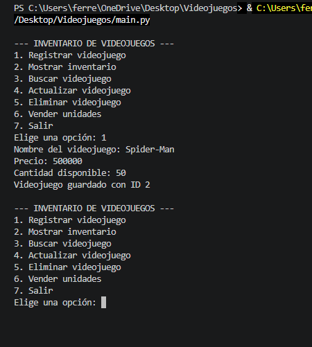
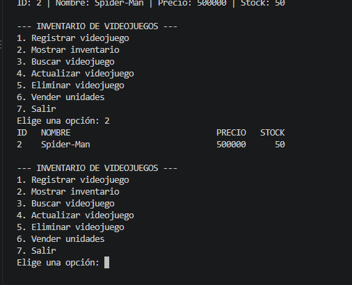
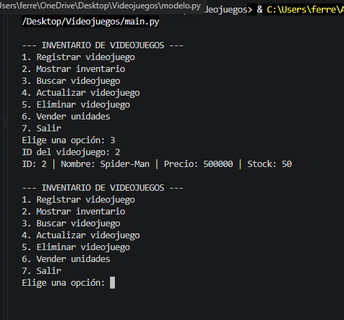
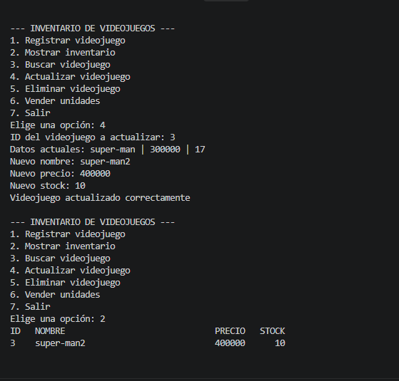
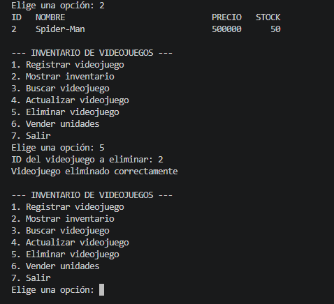

# Sistema de Inventario de Videojuegos

## Propósito

Aplicación de consola en Python para administrar el inventario de una tienda de videojuegos. Permite registrar, consultar, actualizar y eliminar videojuegos (CRUD) y vender unidades, descontándolas del stock. Los datos se guardan en una base de datos SQLite y se conservan entre ejecuciones. El proyecto aplica el patrón **DAO** (Data Access Object) para separar las responsabilidades de cada capa.

## Estructura del proyecto

| Archivo | Responsabilidad |
|---|---|
| `modelo.py` | Clase `Producto` (id, nombre, precio, stock) |
| `base_datos.py` | Conexión a SQLite y creación de la tabla |
| `producto_dao.py` | Clase `ProductoDAO` con todas las operaciones SQL: crear, listar, buscar por ID, actualizar y eliminar |
| `producto_servicio.py` | Clase `ProductoServicio` con las validaciones y reglas del negocio (incluye la venta de unidades) |
| `main.py` | Menú interactivo de consola; solo usa los métodos del servicio |

Flujo de las capas:

```
main.py  →  ProductoServicio  →  ProductoDAO  →  SQLite
(menú)       (validaciones)       (SQL)           (datos)
```

`main.py` no contiene consultas SQL: toda la interacción con la base de datos pasa por el DAO.

## Funcionalidades

1. **Registrar videojuego:** solicita nombre, precio y cantidad disponible.
2. **Mostrar inventario:** lista todos los videojuegos con su ID, nombre, precio y stock.
3. **Buscar videojuego:** consulta un producto por su ID e informa si no existe.
4. **Actualizar videojuego:** modifica nombre, precio y stock de un producto existente.
5. **Eliminar videojuego:** elimina un producto por su ID.
6. **Vender unidades:** solicita el ID y la cantidad, y descuenta las unidades del inventario.
7. **Salir:** finaliza la aplicación.

## Validaciones implementadas

- No se permiten nombres vacíos.
- No se aceptan precios menores o iguales a cero.
- No se permiten cantidades de inventario negativas.
- No se permiten ventas con cantidades menores o iguales a cero.
- No se puede vender más unidades de las disponibles (la operación se rechaza y el stock se conserva).
- Se informa cuando el ID solicitado no existe.
- Una entrada incorrecta (por ejemplo, letras donde va un número) muestra un mensaje de error y no cierra el programa.

## Cómo ejecutar

Requiere **Python 3**. SQLite viene incluido en la biblioteca estándar de Python, por lo que no hay que instalar nada adicional.

Desde la carpeta del proyecto:

```
python main.py
```

En la primera ejecución se crea automáticamente el archivo de base de datos con la tabla de productos. Los datos se conservan entre ejecuciones.

## Evidencias de pruebas

### Operaciones exitosas

**Registrar Resident Evil 4 (precio 180000, stock 10):** el producto se guarda correctamente.



**Mostrar inventario:** aparecen los productos registrados.



**Buscar un ID existente:** se muestran los datos del producto.



**Actualizar un producto:** los cambios quedan guardados en SQLite.



**Eliminar un producto:** el producto deja de aparecer en el inventario.



## Autor

Andres yesid viloria ferrer — Ingeniería de Sistemas, Desarrollo de Aplicaciones con Acceso a Datos
